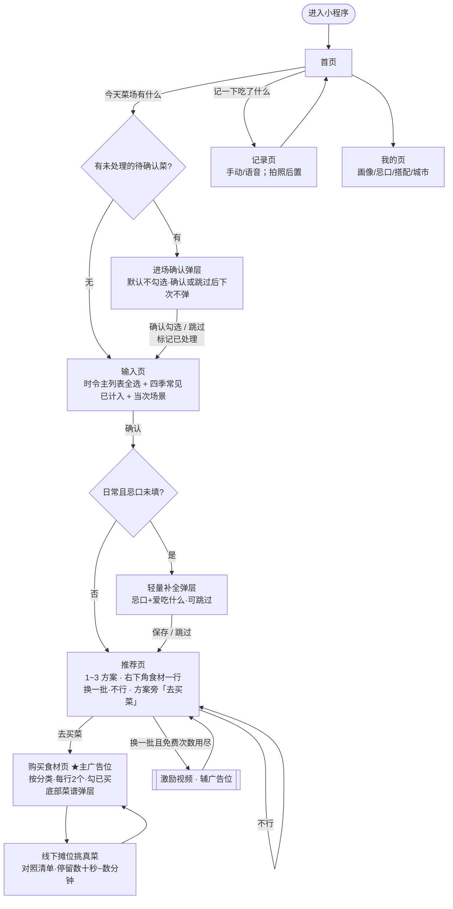
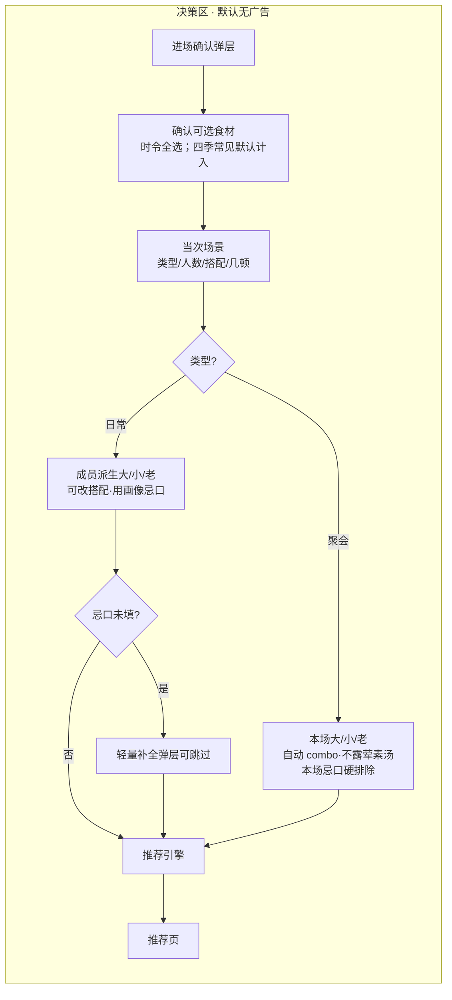
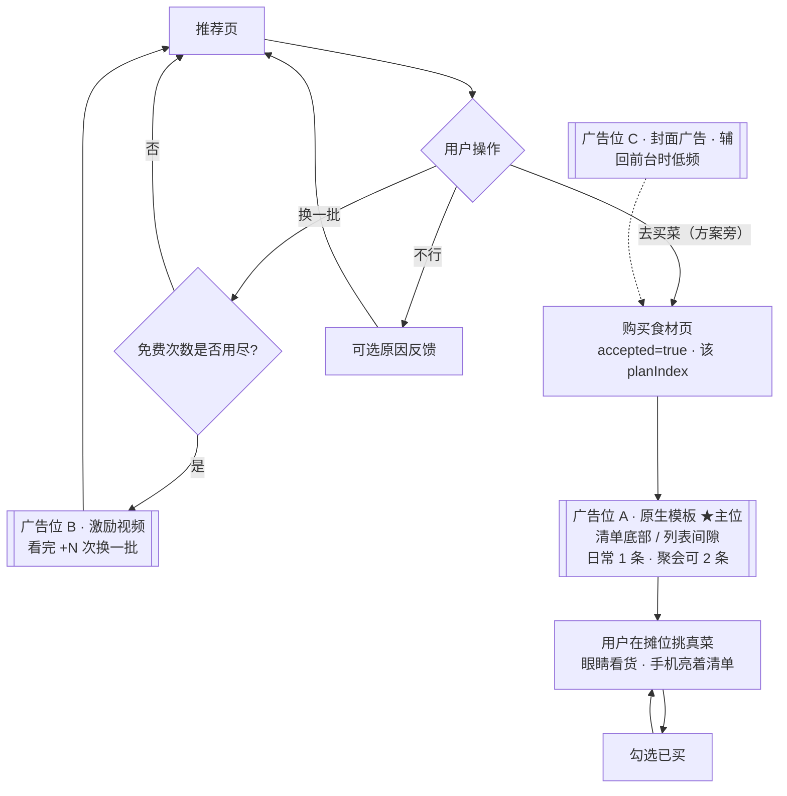
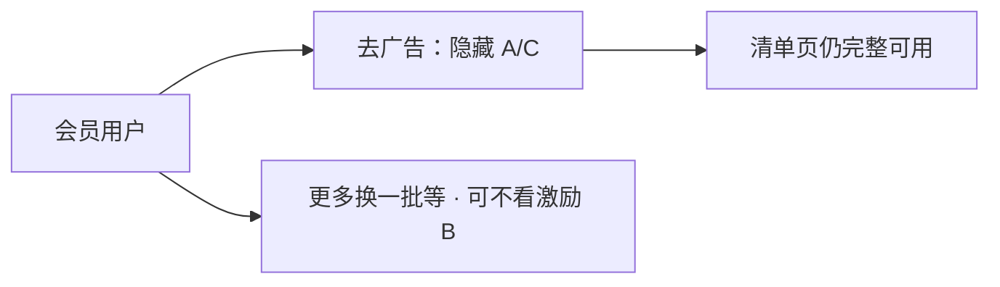
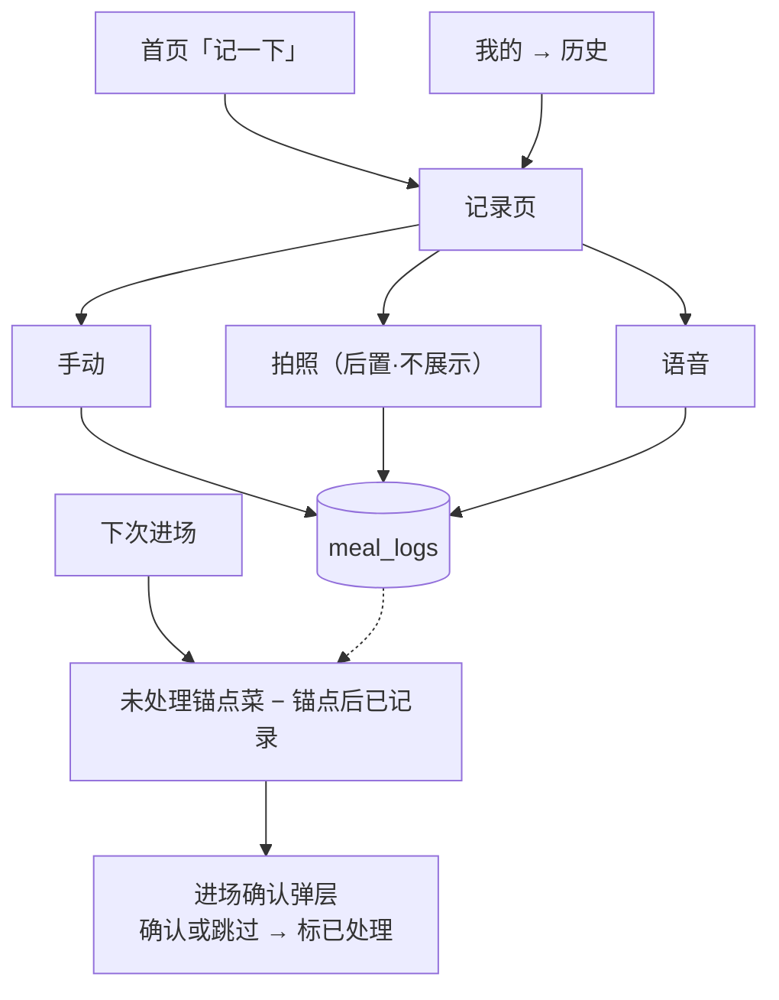
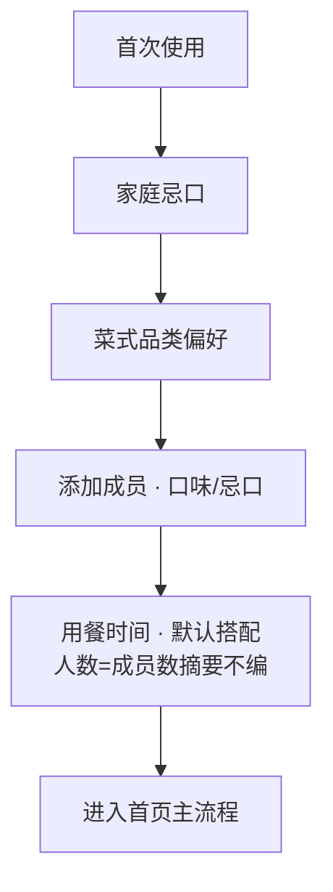

# 买菜做什么 / cookthis — 需求流程图（含广告曝光位）

> 配套：[`需求概述.md`](./需求概述.md)　|　[`盈利模式方案.md`](./盈利模式方案.md)  
> 日期：2026-10-02　|　广告位补充：2026-10-06　|　对齐概述：2026-10-11  
> 说明：流程图描述主业务路径；**广告位**按「先广告、后会员」定稿标注。线下「选菜」= 摊位挑真菜，不是 App 内勾选。

---

## 一、主流程总览

---

## 二、进场 → 出方案（无主广告）

> 此段为决策链路，**不放插屏 / 不强插广告**，避免打断菜场短决策。

**当次场景补充**：

| 类型 | 人数 / 搭配 | 忌口 |
|------|-------------|------|
| 日常 | 成员派生大/小/老；`defaultCombo` 可改 | 家庭忌口硬排除 + 成员忌口软约束 |
| 聚会 | 本场大/小/老（不预填）；`suggestPartyCombo` 自动，页上不改 | 本场忌口硬排除；不写回画像 |

---

## 三、推荐 → 清单 → 摊位采购（广告主战场）

---

## 四、广告曝光位说明

### 4.1 位次一览

| 代号 | 页面 / 时机 | 形态 | 优先级 | 阶段 |
|------|-------------|------|--------|------|
| **A** | **购买食材页**（摊位对照采购时） | 原生模板：底部 / 列表间隙。日常 1 条；**聚会可 2 条**（仍间隙，不插屏） | ★ 主位 | 流量主达标后 |
| **B** | 推荐页「换一批」次数用尽 | 激励视频 | 辅 | 可选，与 A 同期或稍后 |
| **C** | 从后台回前台进入清单相关页 | 封面广告 | 辅 · 低频 | 可选 |
| — | 进场确认 / 输入页 / 出方案前 | 插屏等 | ✗ 明确不做 | — |
| — | 清单对照时全屏挡住清单 | 插屏 | ✗ 明确不做 | — |

### 4.2 主位 A — 为何钉在购买食材页

1. 用户点「去买菜」后，开始**线下摊位挑真菜**，会反复看清单。  
2. 单次停留常有十几秒到数分钟，适合**伴随式曝光**，不要求一直点 App。  
3. 决策已完成，广告不打断「确认食材 → 出方案」。  
4. 清单支持「已买」勾选，拉长停留 = 拉长有效曝光。  
5. **聚会**清单更长、采购更久，同一主位允许加第 2 条原生；日常不加。会员后 A（含第 2 条）一并隐藏。

### 4.3 页面 × 广告矩阵

| 页面 | 广告 | 备注 |
|------|------|------|
| 首页 | 无 | 保持入口干净 |
| 进场确认弹层 | ✗ | 禁止插屏 |
| 输入页（App 勾选食材 + 场景） | ✗ 主路径无广告 | 停留短，且非摊位采购 |
| 推荐页 | 仅 B：次数用尽激励视频 | 方案卡右下角一行食材摘要；完整清单仅「去买菜」进入；无查看清单预览；不在方案卡片中部插屏 |
| **购买食材页** | **A 原生（必做容器）**：日常 1 条，聚会可 2 条；C 封面可选 | 线下选菜时长主战场；第 2 条仅聚会；底部菜谱弹层不挡主勾选列表；**不另加回首页按钮** |
| 记录页 / 我的 | 无 | 后期另议，非当前定稿 |

### 4.4 会员后的变化（阶段 2）

非会员：继续曝光 A（及可选 B/C）。**日常与聚会**主链路均可免费走完，不以锁聚会作付费墙。

---

## 五、饮食记录支线（无广告）

采纳推荐**不**自动写记录；进场确认与主动记录才写入。确认或跳过后同锚点不再弹。

---

## 六、首次画像（侧路径）

可在「我的」随时修改；不在此路径插广告。

---

## 七、状态速查（研发对照）

| 步骤 | 关键状态 / 产出 |
|------|----------------|
| 进场确认 | 确认/跳过 → 标 `entryConfirmHandled`；勾选则写 `meal_logs`（来源：进场确认）；下次同锚点不弹 |
| 输入页确认 | `ingredients[]` + 场景参数（类型、人数、搭配、顿数、当次忌口） |
| 推荐 | `recommendations[]`；换一批=会话内换菜；不行=弹原因（可不选）+ 长期降权；方案卡右下角一行食材 |
| 去买菜（方案旁） | `accepted=true` + 该 `planIndex` → 购买食材页（按分类、每行 2 个；底部菜谱弹层）+ **广告位 A**（聚会可第 2 条）；无预览入口 |
| 摊位采购 | 用户离线动作；App 停留清单页累计曝光时长；可开弹层按菜核对食材 |
| 记录 | 手动/语音/下次进场确认（拍照后置） |

---

## 八、相关文档

| 文档 | 内容 |
|------|------|
| [需求概述.md](./需求概述.md) | 功能与约束全文 |
| [盈利模式方案.md](./盈利模式方案.md) | 先广告后会员定稿、候选方案 |
| [releases/](./releases/) | 需求 v1.0 PDF 归档 |
